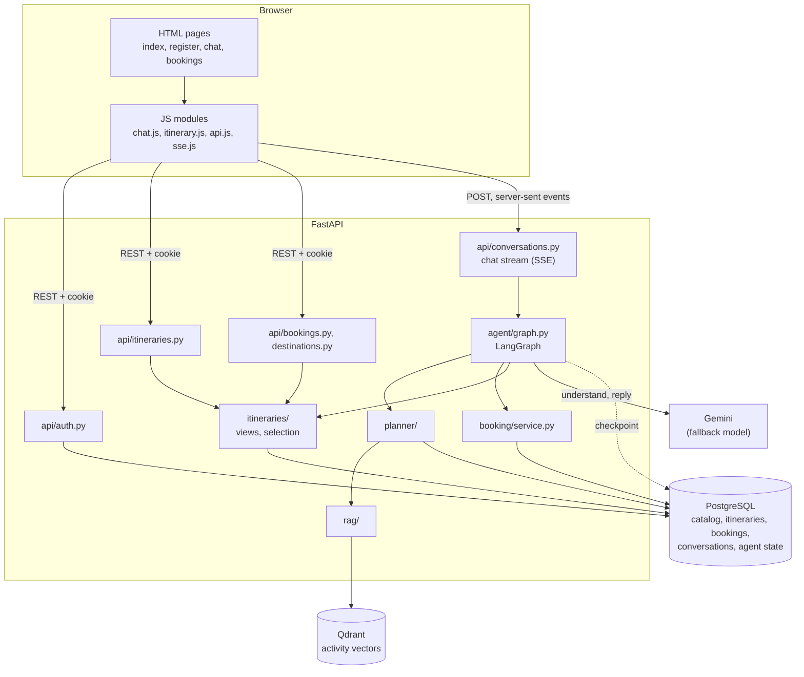
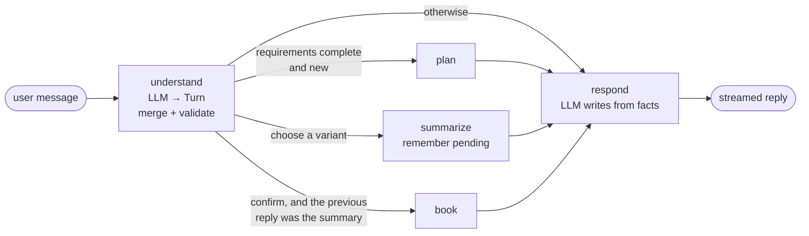
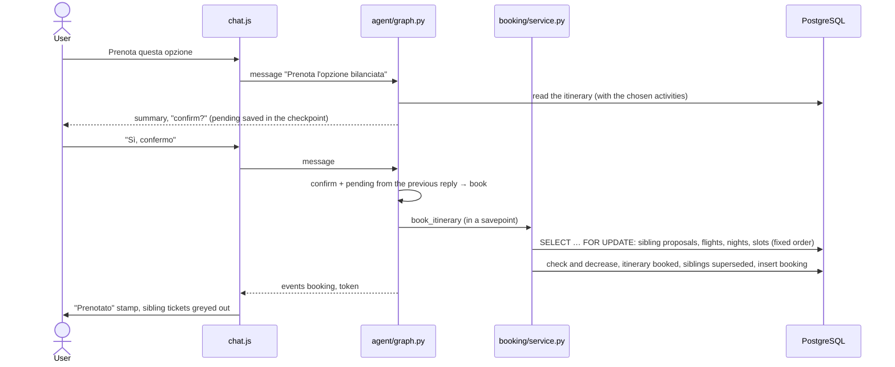

# Architecture

How the Travel Assistant is built and what happens behind every user action. The full design, with the
requirements, the data model and the alternatives considered, is in [design.md](design.md) (Italian).

## Principle: the LLM converses, the code guarantees

| Responsibility | Who |
|---|---|
| Understand the message, write the reply | LLM (Gemini through LangChain) |
| Validate requirements, decide the next step | Python (`agent/requirements.py`, `agent/graph.py`) |
| Flights, rooms, activities, prices, budget | Python planner on PostgreSQL |
| Match activities to preferences in words | RAG: Qdrant + local multilingual embeddings |
| Booking | One database transaction with row locks, reachable only after an explicit confirmation |

## Components



FastAPI also serves the frontend: same address for pages and API, so no CORS and the httpOnly login cookie is sent
automatically, including with the chat stream.

## The agent



- **Two LLM calls per message.** `understand` asks for a structured `Turn` (what the message adds to the
  requirements, and the intent: `trip`, `choose`, `confirm`, `other`). `respond` turns the facts set by the graph
  (questions, proposals, summary, booking result) into text, without inventing numbers.
- **Routing is code.** The LLM never decides to search or to book. A summary is valid only for the very next
  message; anything else cancels it. If the total changed since the summary (an activity swapped in the panel), the
  summary is shown again instead of booking.
- **State** (requirements, current proposals, pending summary) is saved by LangGraph's PostgreSQL checkpointer, one
  thread per conversation, so it survives a restart. Per-request dependencies (database session, user, date,
  ranker) are passed as LangGraph context and never checkpointed.
- **Why not free tool calling:** two predictable calls instead of a variable number fit the free-tier quota, every
  path is testable with a fake LLM, and the confirmation rule does not depend on the model. The cost is less
  freedom to improvise, which this assistant does not need.

## What happens on each user action

### Sending a chat message

```mermaid
sequenceDiagram
    actor U as User
    participant JS as chat.js / api.js / sse.js
    participant API as api/conversations.py
    participant G as agent/graph.py
    participant LLM as Gemini
    participant PL as planner + rag
    participant DB as PostgreSQL
    participant Q as Qdrant

    U->>JS: types and presses Enter
    JS->>API: POST /api/conversations/{id}/messages
    API->>DB: save user message
    API->>G: run the agent (own thread, events through a queue)
    G->>LLM: understand → Turn
    G->>G: merge + validate requirements, route
    G-->>JS: event requirements
    alt requirements complete and new
        G-->>JS: event tool_start
        G->>PL: plan(request, rank)
        PL->>Q: activities of the city, by similarity
        PL->>DB: flights, rooms, slots; save 3 proposals
        G-->>JS: events tool_end, itinerary
    end
    G->>LLM: reply from facts (streamed)
    G-->>JS: events token …
    API->>DB: save reply with its events
    API-->>JS: event done
    JS->>U: requirements bar, proposal tickets, streamed text
```

### Opening the details and swapping an activity

```mermaid
sequenceDiagram
    actor U as User
    participant JS as chat.js / itinerary.js
    participant API as api/itineraries.py
    participant S as itineraries/
    participant DB as PostgreSQL

    U->>JS: clicks Dettagli
    JS->>API: GET /api/itineraries/{id}
    API->>S: itinerary_details (owner only, else 404)
    S->>DB: items, flights, hotel, activities and slots
    API-->>JS: day-by-day program with alternatives
    JS->>U: details panel
    U->>JS: ticks an activity
    JS->>JS: drop overlapping ones, recompute total (instant feedback)
    JS->>API: PUT /api/itineraries/{id}/activities (whole selection)
    API->>S: update_activities: lock row, check every rule first
    S->>DB: replace activity items, new total, commit
    API-->>JS: saved itinerary, or {code} (over_budget, overlap, …)
    JS->>U: total on panel and ticket; rejected → checkbox restored with the reason
```

### Booking



Two bookings that want the same last room run one after the other: the second waits on the lock, then sees no room
left and books nothing. Locking always in the same order prevents deadlocks; locking the whole proposal set
prevents booking two sibling proposals at once. Booking twice returns the first booking.

### Registration, login, opening a page

`register.js` / `login.js` call `/api/auth/register` or `/api/auth/login`; the password is hashed with argon2 and a
signed JWT (24 hours) is set in an httpOnly, SameSite=Lax cookie. Every protected page starts with
`requireUser()` → `GET /api/auth/me`; without a valid cookie it returns to the login page. The chat's welcome
message lists the countries and departures from `GET /api/destinations`.

## The planner

1. **Flights:** outbound in the requested month (from tomorrow) to every airport of the country, return N days
   later, enough seats; the cheapest pairs, a few per airport for variety. Two queries in total.
2. **Hotel:** for each pair, the real check-in and check-out dates; per hotel, the cheapest combination of room types
   that gives everyone a bed and is free every night (exhaustive search, a few dozen combinations at most).
3. **Variants:** cheapest, best hotel, and a balanced score between hotel quality and money left, with three
   different hotels.
4. **Activities:** on full days only, up to two per day, never closer than 30 minutes, chosen round by round in the
   ranker's order with the money left after flights and hotel, so the budget can never be exceeded.
5. **Final check:** every proposal is re-checked; if nothing fits, a typed "no solution" with the reason and the
   minimum cost lets the agent suggest what to change.

## The RAG

Each activity is a Qdrant point whose id is the activity id; the vector embeds "name. description Ideale per
<target>", and the payload carries name, description, country, city, category, target and price, with keyword
indexes on country, city and category. The ranker embeds the user's preferences with the same model, searches
inside the destination city and adds a small bonus for the chosen categories. Without written preferences, or if
Qdrant is down, it falls back to category order: the RAG improves the ranking, it never makes a search fail. Prices
and availability always come from PostgreSQL. With 500 activities Qdrant stays below its indexing threshold and
scores the dozen candidates of a city exactly; HNSW would take over on a much larger catalog.

## Running it

`docker compose up` starts PostgreSQL, Qdrant and the app. The app container creates the tables (including
LangGraph's, never during a request because their indexes are created concurrently), loads the synthetic catalog,
indexes the activities and starts uvicorn; each setup step does nothing if already done.
