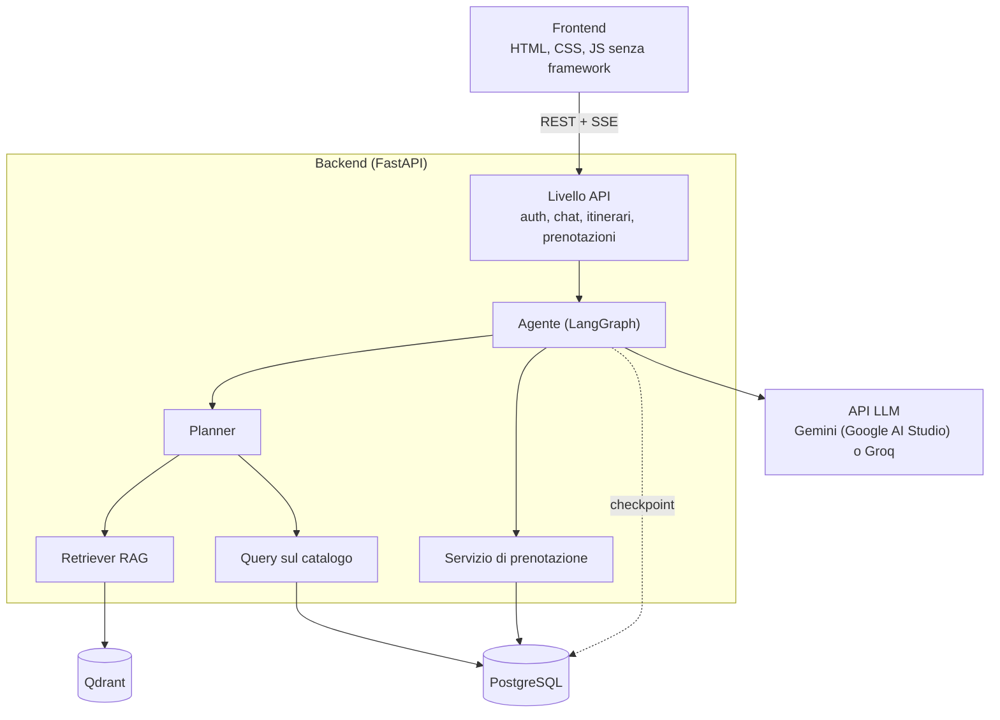
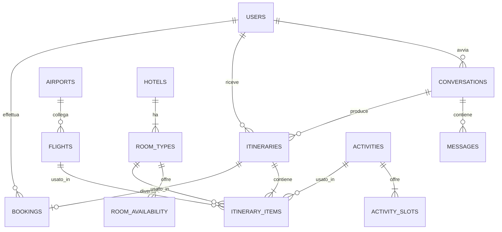
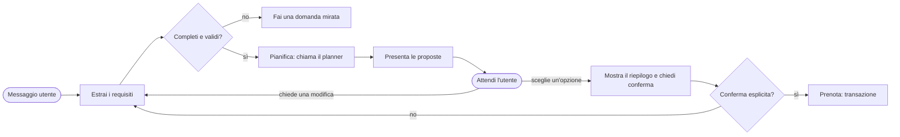

# Travel Assistant — Documento di design

Stato: bozza da rivedere · Data: 14/11/2026 · Scadenza: mercoledì 18/11/2026, sera

## 1. Obiettivo

Un assistente conversazionale per il settore viaggi ed esperienze. L'utente descrive in linguaggio naturale cosa desidera (budget, paese, mese, attività preferite). L'assistente raccoglie e valida questi requisiti, propone itinerari completi (volo di andata e ritorno, un hotel per ogni notte, attività per ogni giorno) che rispettano budget, disponibilità e preferenze, e prenota l'itinerario scelto direttamente in chat. Le prenotazioni vengono salvate e mostrate in una dashboard.

Il progetto è un assessment tecnico per Reply. Oltre a funzionare, deve dimostrare buon giudizio ingegneristico: architettura chiara, vincoli garantiti, storia dei commit leggibile, facilità di avvio per il reviewer.

### Principio guida: l'LLM conversa, il codice garantisce

- L'**agente LLM** capisce l'utente, estrae i requisiti, decide quale strumento chiamare e spiega le proposte.
- Il **codice Python deterministico** cerca voli, hotel e attività, verifica date e disponibilità, somma i costi e prenota dentro una transazione del database. L'LLM non inventa mai un prezzo, una data o una disponibilità.
- Il **RAG** fa da ponte tra i due: trasforma preferenze espresse a parole ("cultura e buon cibo, qualcosa di rilassante") nelle attività più adatte.

## 2. Perimetro

### Obbligatorio (la spec)

- Registrazione e login.
- Chat in linguaggio naturale con un agente che mantiene il contesto.
- Estrazione e validazione dei requisiti: budget, paese, mese, preferenze sulle attività (più i punti mancanti nella spec, vedi §3).
- Generazione dell'itinerario: volo di andata e ritorno, hotel per ogni notte, attività per ogni giorno, nel rispetto di budget e disponibilità.
- Prenotazione dell'intero itinerario tramite chat, con salvataggio dello stato.
- Dashboard con le prenotazioni dell'utente.
- PostgreSQL con utenti, hotel (date e costo per notte), attività (date), voli (aeroporti, date, costo), prenotazioni.
- Database vettoriale (Qdrant) con le descrizioni delle attività e i target ideali, usato per il RAG.
- Backend Python (FastAPI) che espone un'API REST.
- README con le istruzioni di avvio e le note architetturali.

### Consigliato

- Intero sistema avviabile con un solo comando (`docker compose up`), app compresa.
- Test automatici per planner e prenotazione.

### Facoltativo (solo se avanza tempo)

- Cronologia delle conversazioni (barra laterale con le chat passate).

Tagliati per la scadenza: modifica di un itinerario prenotato, cancellazione di una prenotazione, caricamento di immagini.

### Fuori perimetro

- Fornitori reali di voli, hotel o attività: il catalogo è sintetico.
- Pagamenti.
- Viaggi in più città: una sola città di destinazione per viaggio.
- Gruppi oltre 6 persone e sconti per bambini: tutti i viaggiatori pagano uguale.
- Valute multiple: tutto è in euro.

### Da evitare assolutamente (sarebbe un fallimento anche se "funziona")

- Un itinerario fuori budget, o con un hotel o un'attività non disponibile in quella data.
- Una prenotazione fatta senza conferma esplicita dell'utente.
- Prezzi o date presi dal testo dell'LLM invece che dal database.
- Un reviewer che non riesce ad avviare il progetto in pochi minuti.

## 3. Ipotesi che colmano i punti mancanti nella spec

| Punto mancante | Decisione |
|---|---|
| Durata del viaggio (la spec indica solo il mese) | L'agente chiede il numero di notti (da 2 a 14). Se l'utente non ha preferenze, ne propone 5. |
| Aeroporto di partenza (serve per i voli, ma non è tra gli input) | Salvato nel profilo utente alla registrazione; si può cambiare in chat ("stavolta parto da Roma"). |
| Anno del mese indicato | La prossima occorrenza di quel mese in cui il viaggio può iniziare da domani in poi. |
| Prezzo delle attività (la spec cita solo le date) | Le attività hanno un prezzo a persona, necessario per rispettare il budget. |
| Numero di viaggiatori | L'agente lo chiede: da 1 a 6. Voli e attività costano a persona; in hotel si prenotano le camere che servono a dare un letto a tutti (vedi §7). |
| Lingua | Interfaccia in italiano. L'assistente risponde nella lingua in cui scrive l'utente. |

## 4. Architettura

FastAPI serve anche i file del frontend: pagine e API stanno sullo stesso indirizzo. Così non ci sono problemi di CORS e il cookie di login funziona senza configurazioni aggiuntive.

### Stack tecnologico

| Area | Scelta | Motivo |
|---|---|---|
| Backend | Python 3.12+, FastAPI | Richiesto dalla spec (Python + framework web). Validazione e documentazione OpenAPI incluse. |
| ORM | SQLAlchemy 2 + psycopg 3 | Standard, tipizzato, transazioni con blocco delle righe. |
| Database relazionale | PostgreSQL 17 | Blocco a livello di riga per le prenotazioni concorrenti. |
| Database vettoriale | Qdrant 1.19 | Componente separato come descritto nella spec; filtri potenti sui metadati (città, categoria). |
| Embedding | fastembed, modello multilingue locale | Nessuna chiave API necessaria per il RAG; query in italiano e in inglese. |
| Agente | LangGraph + modelli chat di LangChain | Grafo di stati esplicito con controlli; il checkpointer su Postgres rende persistente lo stato della conversazione. |
| LLM | Gemini 3.5 Flash-Lite tramite Google AI Studio (piano gratuito: 15 richieste al minuto, 500 al giorno), con Gemini 3.1 Flash-Lite come riserva automatica (quota separata); Groq come alternativa. Provider e modelli scelti nel `.env` | Nessun costo e nessuna carta di credito, anche per il reviewer. I modelli Flash hanno solo 20 richieste al giorno sul piano gratuito: troppo poche per sviluppo e demo. Tool calling e output strutturato supportati. Il codice dipende da LangChain, non dal provider. |
| Frontend | HTML, CSS, JavaScript senza framework (moduli ES) | Scelta esplicita; nessuno step di build. |
| Autenticazione | JWT in un cookie httpOnly | Token non leggibile da JavaScript; inviato in automatico anche con la richiesta dello stream. |
| Avvio | Docker Compose | Un solo comando per il reviewer. |

## 5. Modello dati

| Tabella | Colonne principali | Note |
|---|---|---|
| `users` | id, email (unica), password_hash, first_name, last_name, home_airport → airports, created_at | |
| `airports` | iata (PK), city, country, is_departure | `is_departure`: aeroporti italiani da cui si parte (NAP, FCO, MXP); gli altri sono destinazioni. |
| `flights` | id, origin → airports, destination → airports, departure_at, arrival_at, price, seats_left | Solo andata; un viaggio di andata e ritorno usa due voli. |
| `hotels` | id, name, city, country, stars, description | |
| `room_types` | id, hotel_id, name, beds | Le tipologie di camera di un hotel (Singola, Doppia, Tripla, Familiare) con i posti letto. Nome unico per hotel. |
| `room_availability` | (room_type_id, night) PK, price, rooms_left | Una riga per tipologia per notte: prezzo di una camera e camere libere. |
| `activities` | id, name, city, country, category, target, price, duration_hours, start_time, description | `description` e `target` finiscono anche in Qdrant. `start_time` è l'ora locale d'inizio, uguale in ogni giorno in cui l'attività si svolge. |
| `activity_slots` | (activity_id, day) PK, spots_left | Una riga per attività per giorno disponibile. |
| `itineraries` | id, user_id, conversation_id, proposal_set_id, variant, travelers (1–6), budget, status, total_cost, start_date, end_date, created_at, superseded_by | Stati: `proposed` (proposto), `superseded` (sostituito), `booked` (prenotato), `cancelled` (annullato). |
| `itinerary_items` | id, itinerary_id, kind, flight_id / room_type_id / activity_id, quantity, day, price | Tipi: `flight_out`, `flight_return`, `hotel_night`, `activity`. Esattamente una delle tre chiavi esterne è valorizzata (vincolo di controllo). `quantity`: posti per voli e attività, camere per una notte d'hotel (almeno 1). `price` è il totale della riga al momento della proposta. |
| `bookings` | id, user_id, itinerary_id (unico), status, total_cost, booked_at | Stati: `confirmed` (confermata), `cancelled` (annullata). |
| `conversations` | id, user_id, title, created_at, updated_at | |
| `messages` | id, conversation_id, role, content, payload (JSON), created_at | `payload` conserva i dati strutturati (proposte, prenotazione) per ricostruire l'interfaccia dalla cronologia. |

Gli importi sono salvati come `NUMERIC(10,2)` e gestiti come `Decimal`, mai come float.

Lo stato dell'agente è salvato dal checkpointer Postgres di LangGraph (nelle sue tabelle), con la conversazione come chiave. La tabella `messages` è quella che mostra l'interfaccia.

### Database vettoriale

Una collezione Qdrant, `activities`, con un punto per ogni attività:

- **vettore:** embedding di `name + description + target`;
- **payload:** `activity_id`, `country`, `city`, `category`, `target`, `price`, con indici keyword su `country`, `city` e `category`.

Il planner la interroga con le preferenze dell'utente come testo, filtrando per la città di destinazione. L'id del punto coincide con l'id dell'attività, così ogni risultato di Qdrant corrisponde direttamente a una riga di Postgres. Disponibilità e prezzo vengono sempre da Postgres, mai dal payload.

## 6. Catalogo sintetico

Generato dagli script in `backend/seed/`, in modo deterministico (seme casuale fisso), per i 12 mesi successivi al giorno in cui si lancia il seed.

- **Aeroporti di partenza:** alcuni italiani (per esempio NAP, FCO, MXP).
- **Destinazioni:** 11 paesi con 3 città ciascuno, 33 città in totale: Giappone, Spagna, Grecia, Portogallo, Francia, Islanda, Regno Unito, Paesi Bassi, Thailandia, Stati Uniti e Italia. Le città italiane di destinazione sono diverse da quelle di partenza.
- **Voli:** giornalieri o quasi, tra aeroporti di partenza e di destinazione; il prezzo varia con la stagione e il giorno della settimana; posti limitati.
- **Hotel:** 200 in totale, 6 o 7 per città, da 2 a 5 stelle; il prezzo per notte varia con la stagione.
- **Tipologie di camera:** generate con una regola fissa. Tutti gli hotel hanno Singola (1 letto, 75% del prezzo della doppia, 2 camere) e Doppia (2 letti, prezzo base, 4 camere); gli hotel da 3 stelle in su hanno anche Tripla (3 letti, 130%, 2 camere) e Familiare (4 letti, 160%, 2 camere).
- **Attività:** 500 in totale, 15 o 16 per città, divise per categoria (cultura, cibo, natura, sport, relax, vita notturna). Ognuna ha un target (famiglie, giovani, coppie, sportivi), un prezzo, una durata, un orario d'inizio e uno schema settimanale di disponibilità con posti limitati. L'orario d'inizio è stato assegnato con una regola: prima le parole nel nome ("all'alba" alle 5:30, "al tramonto" alle 17:30, "serale" o "cena" di sera), poi la durata (le gite di una giornata partono alle 8:30), poi la categoria; ogni attività finisce entro mezzanotte.

I dati di base sono scritti a mano (`airports.json`, `hotels.json`, `activities.json` con le descrizioni); date, prezzi e disponibilità vengono generati da `build_catalog.py`.

## 7. Planner

Python puro, senza LLM, interamente testabile.

**Input:** requisiti già validati: budget (per tutto il gruppo), paese, mese, numero di notti N, numero di viaggiatori P (da 1 a 6), aeroporto di partenza, preferenze come testo e come categorie.

**Passi:**

1. **Voli.** Cerca i voli di andata dall'aeroporto di partenza verso tutti gli aeroporti del paese nel mese indicato (da domani in poi). Per ciascuno cerca i voli di ritorno dalla stessa città N giorni dopo. Tiene le K coppie più economiche (K intorno a 5) con almeno P posti liberi su entrambi i voli. Il costo è il prezzo del posto × P.
2. **Hotel.** Per ogni coppia di voli e per ogni hotel della città di arrivo cerca la **combinazione di camere** più economica che dia almeno P letti e sia libera **tutte** le N notti (una tipologia è utilizzabile solo se ha abbastanza camere libere in ogni notte). A parità di costo preferisce meno letti vuoti, poi meno camere. Con al massimo 6 persone e 4 tipologie le combinazioni sono poche decine: si provano tutte. Il costo è la somma, notte per notte, del prezzo di ogni camera scelta.
3. **Attività.** Chiede al retriever RAG le attività di quella città ordinate per pertinenza rispetto alle preferenze. Per ogni giorno intero (esclusi i giorni di arrivo e di partenza) sceglie fino a 2 attività pertinenti con almeno P posti liberi in quel giorno, **che non si sovrappongono** (almeno 30 minuti tra la fine di una e l'inizio della successiva), nei limiti del budget rimasto. Il costo è il prezzo a persona × P. Per ogni giorno restituisce anche le **alternative**: tutte le altre attività di quella città disponibili per P persone quel giorno, comprese quelle che si sovrappongono alle scelte (l'utente può scambiarle, vedi §11 bis).
4. **Varianti.** Tra i candidati sceglie fino a tre itinerari diversi tra loro:
   - **Economica:** costo totale più basso.
   - **Bilanciata:** il miglior equilibrio tra pertinenza, qualità dell'hotel e costo.
   - **Comfort:** la migliore qualità dell'hotel, poi la pertinenza.
5. **Controllo finale.** Ogni itinerario restituito ha un totale non superiore al budget, ogni notte coperta dall'hotel e ogni elemento disponibile nella sua data. Se nessuna combinazione funziona, restituisce un risultato "nessuna soluzione" tipizzato, con il motivo e il costo minimo possibile, così l'agente può suggerire meno notti, un altro mese o un budget più alto.

I pesi per la variante bilanciata li sceglie chi implementa; i vincoli del controllo finale non sono negoziabili.

## 8. Agente

Un grafo di stati LangGraph, con un thread per ogni conversazione.

- **Stato:** i requisiti raccolti finora, i campi mancanti, l'insieme di proposte corrente, l'itinerario in attesa di conferma (se c'è), l'ultima prenotazione.
- **Estrazione:** l'LLM restituisce un output strutturato (modello Pydantic), unito ai requisiti precedenti, così l'utente può cambiare una cosa alla volta.
- **Validazione:** regole Pydantic (budget > 0, mese da 1 a 12, notti da 2 a 14, viaggiatori da 1 a 6, paese presente nel catalogo, categorie note). Se l'utente non indica la partenza, si usa l'aeroporto del suo profilo.
- **Destinazioni disponibili:** l'agente sa sempre per quali paesi può creare un itinerario, perché l'elenco viene letto dal catalogo e inserito nel suo prompt di sistema (mai scritto a mano). Lo dice nel messaggio di benvenuto, quando l'utente chiede "dove posso andare?" e quando chiede un paese che non c'è: in quel caso spiega che non è disponibile e propone l'elenco, invece di inventare un itinerario.
- **Strumenti a disposizione dell'LLM:** elencare le destinazioni disponibili (paesi e città), cercare gli itinerari (richiama il planner) e leggere i dettagli di un itinerario. **La prenotazione non è uno strumento libero**: è un nodo del grafo che si raggiunge solo dopo che l'utente ha visto il riepilogo e ha confermato in modo esplicito. Così la regola "nessuna prenotazione senza conferma" è garantita dalla struttura del grafo, non dal prompt.
- **Risposte:** l'LLM scrive il testo. Prezzi e date nel testo vengono dalla proposta strutturata che riceve, e l'interfaccia mostra le proposte a partire dagli eventi strutturati, non dal testo.

## 9. API REST

| Metodo e percorso | A cosa serve |
|---|---|
| `POST /api/auth/register` | Crea un utente (email, password, nome, cognome, aeroporto di partenza). |
| `POST /api/auth/login` | Verifica le credenziali e imposta il cookie JWT. |
| `POST /api/auth/logout` | Cancella il cookie. |
| `GET /api/auth/me` | Utente corrente. |
| `GET /api/airports` | Aeroporti di partenza per il modulo di registrazione. |
| `GET /api/destinations` | Paesi e città disponibili, per il messaggio di benvenuto della chat. |
| `GET /api/conversations` | Conversazioni dell'utente (barra della cronologia). |
| `POST /api/conversations` | Avvia una conversazione. |
| `GET /api/conversations/{id}` | Messaggi di una conversazione. |
| `POST /api/conversations/{id}/messages` | Invia un messaggio; la risposta è uno stream SSE. |
| `GET /api/itineraries/{id}` | Itinerario completo, giorno per giorno, con le attività alternative di ogni giorno. |
| `PUT /api/itineraries/{id}/activities` | Salva le attività scelte dall'utente in un itinerario proposto; il server ricalcola il totale (vedi §11 bis). |
| `GET /api/bookings` | Prenotazioni dell'utente. |
| `GET /api/bookings/{id}` | Una prenotazione con il suo itinerario. |
| `GET /api/health` | Controllo di funzionamento. |

Non c'è volutamente un endpoint pubblico per creare una prenotazione: si prenota solo tramite la chat, come chiede la spec.

## 10. Protocollo di streaming (SSE)

L'endpoint dei messaggi restituisce `text/event-stream`. Ogni evento ha un tipo e un payload JSON:

| Evento | Payload | Effetto nell'interfaccia |
|---|---|---|
| `requirements` | budget, paese, mese, notti, viaggiatori, partenza, preferenze, campi mancanti | Aggiorna i requisiti mostrati in chat. |
| `tool_start` / `tool_end` | nome dello strumento, etichetta leggibile | Indicatori di stato ("Cerco voli…"). |
| `itinerary` | id dell'insieme di proposte, id dell'insieme che sostituisce, opzioni con riepilogo (variante, città, hotel, totale, quota del budget) | Mostra le righe delle proposte; mette in grigio quelle sostituite. |
| `token` | un pezzo di testo | Fa scorrere il messaggio dell'assistente. |
| `booking` | id della prenotazione, id dell'itinerario, stato | Mostra "Prenotato" e aggiorna la dashboard. |
| `error` | codice, messaggio | Mostra l'errore e permette di riprovare. |
| `done` | id del messaggio salvato | Chiude lo stream. |

Il client legge lo stream con `fetch` e un piccolo parser (`EventSource` supporta solo GET). I messaggi vengono salvati alla fine dello stream: ricaricando la pagina, la conversazione si ricostruisce da `GET /api/conversations/{id}`.

## 11. Prenotazione e concorrenza

Tutto avviene in un'unica transazione del database:

1. Carica l'itinerario: deve appartenere all'utente ed essere `proposed`. Se è già `booked`, restituisce la prenotazione esistente (operazione idempotente).
2. Blocca le righe di disponibilità con `SELECT … FOR UPDATE`, sempre nello stesso ordine (voli, poi notti delle tipologie di camera, poi posti nelle attività, ognuno ordinato per chiave), per evitare deadlock.
3. Verifica che ogni riga abbia ancora almeno la quantità richiesta (posti per i voli e le attività, camere per ogni notte); se no, annulla la transazione e indica quale elemento non è più disponibile.
4. Scala da ogni riga la quantità della voce corrispondente; imposta l'itinerario come `booked`, segna come `superseded` le altre proposte dello stesso insieme; inserisce la prenotazione.
5. Conferma la transazione (commit).

In caso di errore l'agente spiega cosa è cambiato e propone di cercare di nuovo.

## 11 bis. Scelta delle attività

Nel pannello "Dettagli" ogni giorno è un piccolo orario in ordine cronologico: le attività scelte dal planner sono spuntate, le alternative compaiono al loro posto non spuntate, ognuna con orario, prezzo a persona e prezzo per il gruppo. Spuntando o togliendo una casella, totale e barra del budget si aggiornano subito nella pagina, e la selezione viene salvata con `PUT /api/itineraries/{id}/activities`.

Regole, verificate dal server a ogni salvataggio (la pagina le anticipa solo per rispondere subito):

- **Solo sulle proposte:** l'itinerario deve appartenere all'utente ed essere `proposed`. Prenotato o sostituito: sola lettura.
- **Solo giorni interi del viaggio,** esclusi arrivo e partenza, e solo attività della città dell'itinerario, nei giorni in cui si svolgono, con almeno P posti liberi.
- **Nessuna sovrapposizione:** due attività dello stesso giorno devono distare almeno 30 minuti. Le attività che si sovrappongono compaiono tutte, ma se ne può spuntare una sola alla volta: spuntandone una, quelle in conflitto si tolgono da sole, e una riga dice cosa è stato tolto e perché. Il server rifiuta comunque qualsiasi selezione con due attività sovrapposte.
- **Budget rigido:** il totale ricalcolato dai prezzi del database non può superare il budget dell'itinerario. Se lo supera, la modifica non viene salvata e il messaggio suggerisce di togliere un'attività o di alzare il budget in chat.
- **Salvataggio automatico** a ogni clic. Se il server rifiuta (per esempio l'attività si è appena esaurita), la casella torna com'era e compare il motivo.

Prenotare resta possibile solo in chat: l'agente prenota l'itinerario con le attività scelte, leggendole dal database.

## 12. Frontend

- **Pagine:** `index.html` (login), `register.html`, `chat.html`, `bookings.html`, servite da FastAPI.
- **Layout della chat (opzione C):** la conversazione occupa la colonna principale. Le proposte compaiono dentro il messaggio dell'assistente come righe compatte (variante, città e hotel, prezzo, "Dettagli"). "Dettagli" apre un pannello laterale con il programma giorno per giorno e il pulsante "Prenota questa opzione".
  - Quando arrivano nuove proposte, le righe precedenti diventano grigie con l'etichetta "sostituita".
  - Se l'itinerario aperto viene aggiornato, il pannello laterale si aggiorna sul posto con l'etichetta "aggiornata".
  - Su mobile il pannello laterale diventa un foglio a tutto schermo.
- **Pulsante di prenotazione:** invia un messaggio in chat ("Prenota l'opzione bilanciata"); l'agente mostra il riepilogo e chiede conferma. Un solo percorso per prenotare, sempre attraverso l'agente.
- **Barra della cronologia:** elenco delle conversazioni passate (facoltativo).
- **Codice:** moduli ES: `api.js`, `auth.js`, `sse.js`, `chat.js`, `itinerary.js` (righe e pannello laterale, riusato dalla dashboard), `bookings.js`, `format.js`.
- **Direzione visiva (scelta di Ciro dopo due giri di anteprime):** carta d'imbarco su palette cielo. Ogni proposta è un tagliando: a sinistra della perforazione tratteggiata la tratta in grande (per esempio NAP → HND), a destra variante, hotel e prezzo. È l'unico gesto forte; il resto è sobrio.
  - Colori: cielo `#F2F7FB` (sfondo), carta `#FFFFFF`, inchiostro `#183247`, azzurro `#2F86C9` (azione principale, selezione, date), nuvola `#D6E5F0` (bordi), perforazione `#BFD6E7`, nebbia `#5D7A90` (testo secondario).
  - Caratteri: Barlow Condensed per tratte, prezzi, orari e titoli; DM Sans per il resto.
  - Proposta selezionata: bordo azzurro di 2 px e tagliando della tratta azzurro pieno con testo bianco, più la scritta "Aperta nei dettagli" (lo stato non è affidato solo al colore). Sostituita: bordo tratteggiato e testo spento.
  - Prenotazione confermata: un timbro "Prenotato" sul tagliando, in chat e nella pagina delle prenotazioni. È l'unico momento con un gesto decorativo.

## 13. Autenticazione

- Password salvate con un algoritmo di hashing moderno (argon2 o bcrypt, a scelta di chi implementa).
- Il login restituisce un JWT firmato (HS256, `JWT_SECRET`, scadenza 24 ore) in un cookie httpOnly con SameSite=Lax.
- Una dipendenza FastAPI (`get_current_user`) protegge tutti gli endpoint tranne registrazione, login, aeroporti, destinazioni e controllo di funzionamento.
- Le pagine chiamano `/api/auth/me` all'apertura e, se serve, rimandano al login.
- **Limite noto, accettato:** un JWT non si può revocare prima della scadenza. Il logout cancella il cookie dal browser, ma un token copiato altrove resterebbe valido fino a 24 ore. Valutate le sessioni lato server (logout vero, una tabella in più): scartate per la scadenza, la differenza qui è piccola. In produzione: token brevi con refresh token, oppure sessioni lato server.

## 14. Test

| Area | Cosa si verifica |
|---|---|
| Planner | Su molte richieste casuali: totale mai sopra il budget, ogni notte coperta, ogni elemento disponibile nella sua data, voli coerenti con le N notti, letti sufficienti per tutti i P viaggiatori. Combinazione di camere più economica su casi noti (per esempio 5 persone: familiare + singola contro tripla + doppia). Risultato "nessuna soluzione" quando il budget è troppo basso. |
| Prenotazione | Caso normale; idempotenza; due prenotazioni simultanee per l'ultima camera: ne riesce esattamente una; due gruppi da 3 che si contendono gli ultimi 4 posti di un volo: ne riesce esattamente uno. |
| Requisiti | Regole di validazione e unione degli aggiornamenti parziali. |
| Autenticazione | Registrazione, login, endpoint protetto senza e con cookie. |
| Scelta delle attività | Totale ricalcolato; rifiuto di: itinerario altrui, prenotato o sostituito; giorno fuori dal viaggio; attività di un'altra città o non disponibile; sovrapposizione; budget superato. |
| Agente | Alcune conversazioni scriptate con un LLM finto: i dati mancanti generano una domanda; un paese non disponibile riceve l'elenco dei paesi disponibili; nessuna prenotazione senza conferma. |

I test girano su un database PostgreSQL di test separato: il blocco delle righe non si può testare su SQLite.

## 15. Consegna

- README: cos'è, requisiti, come avviarlo (un comando), come provarlo (utente demo, messaggi di esempio), come lanciare i test.
- `docs/ARCHITECTURE.md`: diagrammi e motivazioni di ogni scelta.
- `docker-compose.yml` con `app`, `postgres` e `qdrant`; l'app aspetta che il database sia pronto e carica il catalogo al primo avvio.
- Una breve GIF o un video del flusso completo.
- Tag `v1.0` su `main`.

## 16. Piano e calendario

Un branch per fase, unito a `main` tramite pull request.

| Giorno | Branch |
|---|---|
| Sab 14 | `chore/setup` (fatto), `docs/design` (fatto) |
| Dom 15 | `feat/database` (modelli, seed) |
| Lun 16 | `feat/auth`, `feat/planner` (con test) |
| Mar 17 | `feat/rag`, `feat/agent` (grafo, endpoint della chat, SSE), `feat/booking` (con test) |
| Mer 18 | `feat/frontend` (chat, pannello laterale, dashboard), Docker Compose completo, `docs/final`, demo, `v1.0` |

Aggiunte del 16/11: scelta delle attività con orari (circa 3 ore in più, divise tra `feat/planner`, `feat/booking` e `feat/frontend`); il frontend parte in anticipo, dopo `feat/auth`, con dati finti per la chat.

Calendario rivisto il 15/11: il lavoro procede file per file, con spiegazione approfondita sulle parti con logica (planner, prenotazione, agente, streaming, chat) e più rapida su quelle ripetitive.

Le funzionalità facoltative partono solo quando le consegne di mercoledì sono al sicuro.

## 17. Alternative valutate

| Decisione | Opzioni | Scelta | Motivo |
|---|---|---|---|
| Framework per l'agente | LangGraph; ciclo di tool calling scritto a mano; slot-filling a regole con LLM solo per l'estrazione | LangGraph | Fasi e controlli sono espliciti nel grafo; lo stato persistente arriva con il checkpointer; è uno standard per l'AI agentica. Il ciclo scritto a mano richiede di costruire stato e controlli da zero; lo slot-filling è rigido e mostra poco della parte agentica. |
| Database vettoriale | Qdrant; pgvector; Chroma | Qdrant | La spec descrive un database vettoriale separato; filtri potenti sui metadati; un solo container. pgvector era l'alternativa seria (un database in meno); Chroma è pensato soprattutto per i prototipi. |
| Frontend | HTML/CSS/JS senza framework; React | Senza framework | Scelta di Ciro. Nessuno step di build; FastAPI serve i file. |
| Layout delle proposte | A split view; B card nella chat; C righe nella chat + pannello laterale; D barra in alto; E pannello comprimibile | C | Scelta di Ciro dopo le anteprime. La chat resta al centro; i dettagli si aprono quando servono. |
| Container | Uno per servizio; tutto in uno | Uno per servizio | Buona pratica di Docker; immagini ufficiali; cicli di vita indipendenti. |
| Provider LLM | Gemini (AI Studio, gratuito); Groq (gratuito); OpenRouter, modelli `:free`; Anthropic o OpenAI (a pagamento) | Gemini, con Groq come alternativa | Requisito di Ciro: nessun costo. Gemini ha limiti gratuiti adatti a una demo e un buon tool calling. Groq è molto veloce ma il limite di token al minuto del piano gratuito è stretto per un agente con strumenti. OpenRouter senza acquisti concede solo 50 richieste al giorno. Nota: i dati inviati sul piano gratuito di Google possono essere usati per migliorare i prodotti; qui sono dati sintetici e messaggi di prova. |
| Streaming | SSE; WebSocket | SSE | Basta una comunicazione dal server al client; HTTP semplice; facile da implementare in FastAPI. |

## 18. Decisioni lasciate a chi implementa

- Il modello di embedding esatto (un modello multilingue di fastembed, per esempio `paraphrase-multilingual-MiniLM-L12-v2`).
- I pesi del punteggio della variante bilanciata e il numero K di coppie di voli.
- La libreria per l'hashing delle password.
- Il testo dei prompt.
- Il contenuto esatto del catalogo (nomi, descrizioni, prezzi), nella forma descritta in §6.
